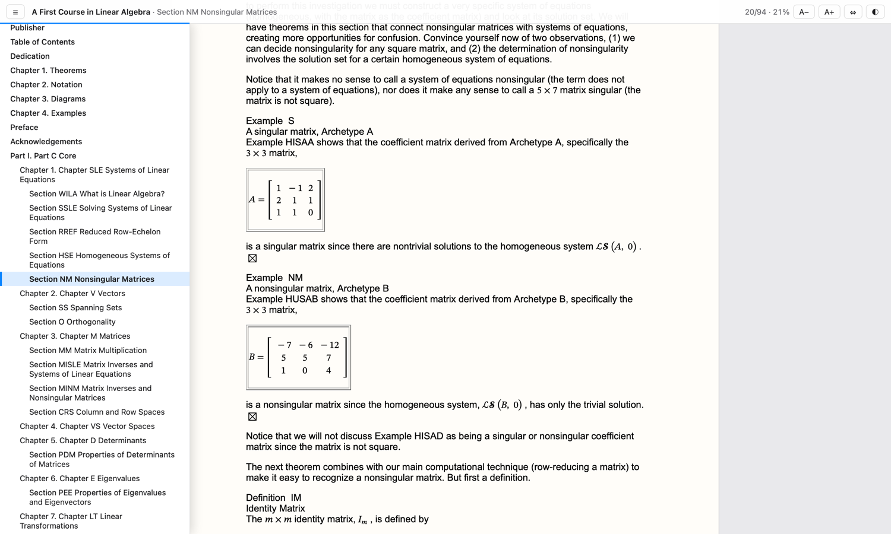

# EPUB Quick Look Extension

A macOS Quick Look extension that previews `.epub` books in Finder. Select a book and press **Space**.

> Fork of [arytek/epub-quicklook-extension](https://github.com/arytek/epub-quicklook-extension) with a rewritten rendering engine (2.0); see the [changelog](CHANGELOG.md).



## Features

- **Faithful rendering.** Every chapter is shown with its own stylesheets, images, embedded
  fonts (including obfuscated ones), MathML and SVG, so textbooks look like they do in a
  dedicated reader.
- **Whole book, one scroll.** Chapters load as you approach them and unload when far
  away, so even 400-chapter books open instantly.
- **Navigation.** Table of contents sidebar that follows along; footnotes and
  cross-references jump within the preview.
- **Comfort.** Text size, page width, light/sepia/dark themes. Settings and your reading
  position are remembered.
- **Layouts.** Reflowable books, fixed-layout comics and picture books, vertical
  Japanese/Chinese text, and right-to-left scripts.
- **Safe.** Book scripts never run and previews can't touch the network.

| Key | Action |
| --- | --- |
| `T` | Table of contents |
| `+` / `−` | Text size |
| `D` | Theme: light → sepia → dark |
| `W` | Page width |
| `[` / `]` | Previous / next section |

## Requirements

macOS 12 or later.

## Install

### Download

1. Get the `.dmg` from the [latest release](../../releases/latest), open it, and drag
   **EPUBQuickLookHost** into **Applications**.
2. The build isn't notarized by Apple, so macOS blocks it until you clear the download
   quarantine once:
   ```bash
   xattr -dr com.apple.quarantine /Applications/EPUBQuickLookHost.app
   ```
3. Open **EPUBQuickLookHost** once. Then select an `.epub` in Finder and press **Space**.

### Build from source

Requires [Xcode](https://apps.apple.com/app/xcode/id497799835).

```bash
git clone https://github.com/cowkoi/epub-quicklook-extension.git
cd epub-quicklook-extension
./scripts/install.sh
```

The script signs with your Apple Development certificate if you have one (a free Apple ID
account in Xcode is enough) and ad hoc otherwise, copies `EPUBQuickLookHost.app` to
`/Applications`, and registers the extension.

## Troubleshooting

- Check the extension is registered and enabled (a leading `+`):
  ```bash
  pluginkit -m -p com.apple.quicklook.preview | grep -i EPUBQuickLook
  ```
  If it shows `-`, enable it in **System Settings → General → Login Items & Extensions →
  Quick Look** (the host app has a button that opens this page).
- If nothing changes after installing a new version:
  ```bash
  qlmanage -r
  killall -u "$USER" QuickLookUIService
  ```
- `qlmanage -p book.epub` previews a file from Terminal. Errors are logged under the
  `EPUBQuickLook` subsystem:
  ```bash
  log stream --predicate 'subsystem == "EPUBQuickLook"'
  ```
- DRM-protected books can't be previewed; the preview says so.

## How it works

```
Finder ──Space──▶ PreviewProvider (sandboxed .appex)
                    │  EPUBBook.parse: container.xml → OPF → spine, TOC, fonts
                    ▼
                  WKWebView ── epub-ql://book/… ──▶ BookSchemeHandler ─▶ BookServer
                    │                                  reads entries straight from the ZIP,
                    │                                  de-obfuscates fonts, adds CSP headers
                    ▼
                  viewer.html/js: one sandboxed iframe per chapter, lazily loaded
                  and auto-sized; TOC, links, themes, position tracking
```

- `EPUBQuickLook/Core/`: platform-independent parsing and serving (unit-tested through SwiftPM).
- `EPUBQuickLook/Viewer/`: the reader UI (plain HTML/CSS/JS, no dependencies).
- `EPUBQuickLook/PreviewProvider.swift`, `BookSchemeHandler.swift`: the WebKit glue.

Serving everything from a custom URL scheme gives the reader and the chapters one
origin, so the reader can measure and style chapters without WebKit's private
file-access flags, and nothing is ever extracted to disk.

## Development

```bash
swift test                                   # unit tests for the core
EPUB_CORPUS=~/books swift test               # also parse every .epub in a folder
```

CI runs the tests against the [IDPF EPUB 3 samples](https://github.com/IDPF/epub3-samples)
and builds the app. To iterate on the extension, open `EPUBQuickLookHost.xcodeproj`, run
the **EPUBQuickLookHost** scheme once, then use the **EPUBQuickLook** scheme with
`qlmanage -p` as the host.

## Credits

[Aryan Nateghnia (Arytek)](https://github.com/arytek)

[ZIPFoundation](https://github.com/weichsel/ZIPFoundation)

## License

MIT
